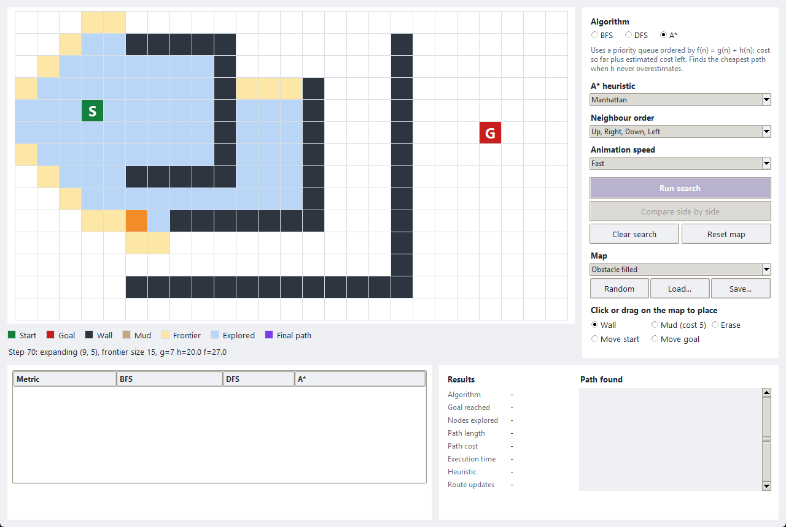

# BFS, DFS and A* Search

An educational program that runs Breadth-First Search, Depth-First Search and A*
on the same grid map, animates how each one searches, and compares the measured
results.



The write-up (algorithm explanations, comparison, conclusions and test results)
is in [REPORT.md](REPORT.md).

## Install

You need Python 3.10 or newer. There is nothing else to install: the program uses
only the standard library, and Tkinter comes with the python.org installer for
Windows and macOS.

On Linux, Tkinter may be a separate package:

```
sudo apt install python3-tk
```

If Tkinter is missing, the program starts its console version instead.

## Run

Run these from the project folder.

| Command | What it does |
| --- | --- |
| `python main.py` | Opens the graphical interface |
| `python main.py --console` | Opens the text menu |
| `python main.py --map maps/3_multiple_paths.txt` | Compares all three on one map and exits |
| `python main.py --map maps/3_multiple_paths.txt --algorithm DFS` | Runs one algorithm and draws the result |
| `python -m unittest discover -s tests -v` | Runs all the tests |
| `python run_scenarios.py` | Runs every scenario and rewrites `results/measured_results.md` |

`tools/capture_screenshots.py` recreates the screenshots. It is the only script
that needs an extra package (`pip install pillow`).

## Using the window

1. Pick a map from the **Map** list, or press **Random** or **Load...**.
2. Pick **BFS**, **DFS** or **A\***.
3. Press **Run search** to watch it. When it finishes, the results panel and the
   comparison table fill in with values from all three algorithms.
4. Press **Compare side by side** to watch all three at once.

To edit the map, choose a tool under **Click or drag on the map to place**, then
click or drag on the grid. You can also drag the S and G markers directly. Editing
the map clears old results, so what is on screen always matches the map.

- **Clear search** removes the search results and keeps the map.
- **Reset map** restores the map as it was loaded.

## Map files

A map is a text file with one row per line. All rows must be the same length.

| Character | Meaning | Cost to enter |
| --- | --- | --- |
| `.` | Open ground | 1 |
| `~` | Mud | 5 |
| `#` | Wall | Cannot be entered |
| `S` | Start (exactly one) | 1 |
| `G` | Goal (exactly one) | 1 |
| `*` | Start and goal on the same cell | 1 |

Any `.txt` file added to `maps/` appears in the **Map** list. Maps can be up to
100 cells on each side.

## Project layout

```
main.py             Starts the program and reads command-line options
gui.py              Tkinter interface
console.py          Text menu and text drawing of maps
sample_maps.py      Finds the maps in maps/
run_scenarios.py    Records measured results for every scenario
search/
    grid_map.py     The map, its validation, and its neighbour rules
    bfs.py          Breadth-First Search
    dfs.py          Depth-First Search
    astar.py        A* Search
    heuristics.py   Heuristics for A*
    result.py       Search results and path reconstruction
    runner.py       Timing and the comparison table
maps/               Sample maps, plus maps/invalid/ for trying error handling
tests/              Unit and GUI tests
results/            Measured results, test output, and a console session
screenshots/        Pictures of the working program
tools/              Screenshot script
```
