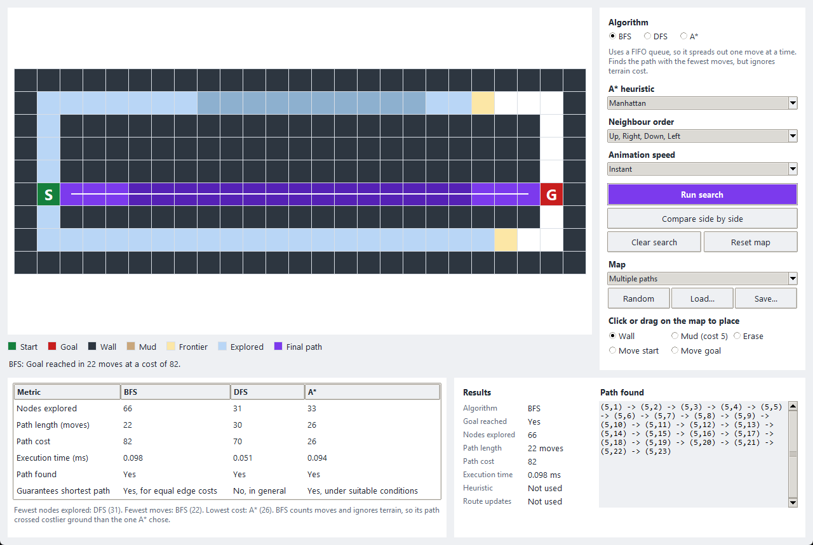
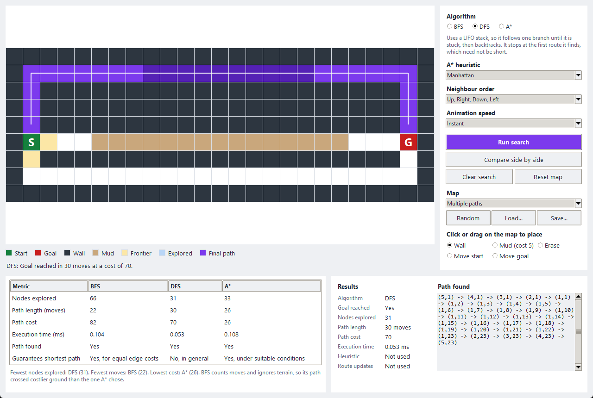
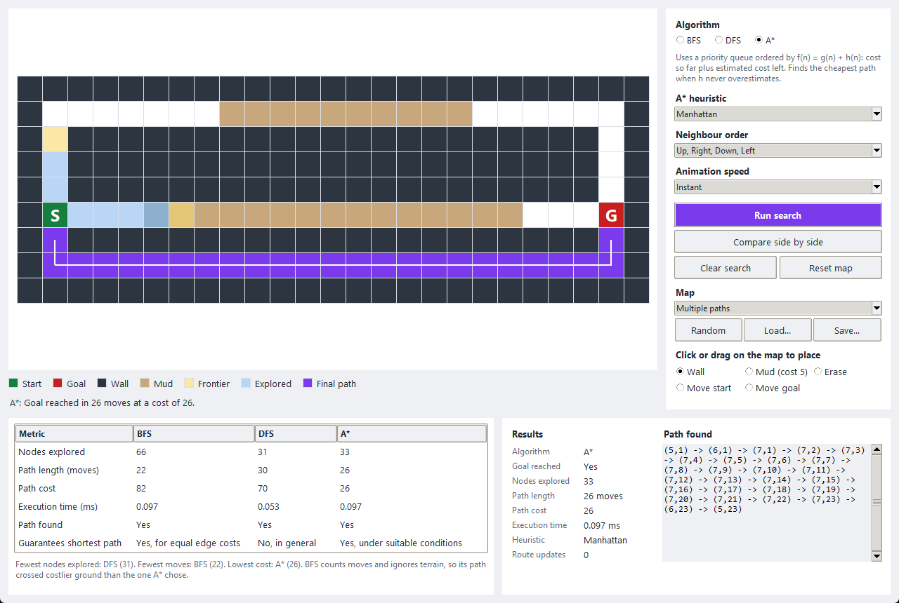
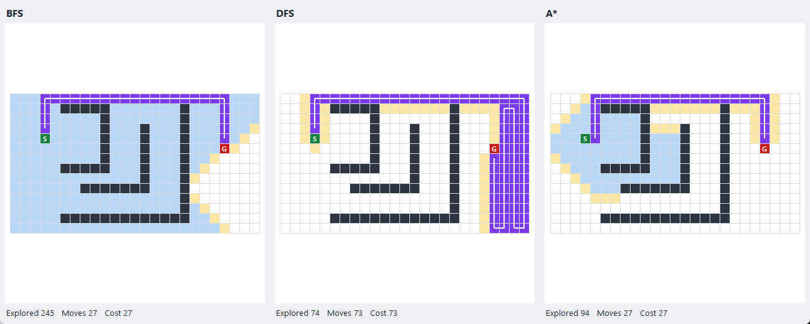
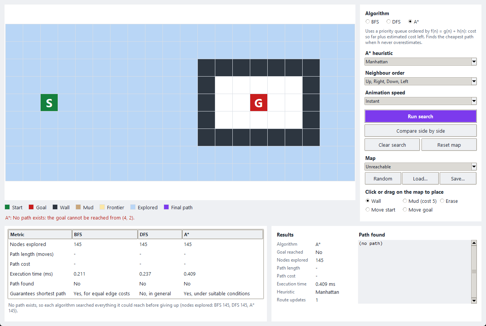

# BFS, DFS and A* Search: Project Report

## 1. Summary

This program implements Breadth-First Search (BFS), Depth-First Search (DFS) and
A* from scratch in Python, without any pathfinding library. It runs them on the
same editable grid map and compares the results using values measured during the
run.

The main finding is that no algorithm wins on every measure. On the multiple-paths
map, all three returned a different route: BFS found the fewest moves (22), A*
found the lowest cost (26), and DFS explored the fewest nodes (31) but returned a
route that was neither the shortest nor the cheapest.

All 62 automated tests passed on the final code.

## 2. Design

**Language and interface.** Python was used because it was available with Tkinter,
so the program has a graphical interface and needs no extra packages. A console
version offers the same core features and starts automatically if Tkinter is
missing.

**Map.** The map is a grid in which each cell is a node, and edges join cells that
are next to each other. Movement is in four directions only. Walls block movement.
Open ground costs 1 to enter and mud costs 5. Mud was added because BFS and A*
behave identically in cost terms when all edges are equal, so a map with only open
ground could not show why A* needs g(n) to be a real cost.

**Structure.** Each algorithm is in its own module with the same form: it takes a
map, a start and a goal, and returns a `SearchResult`. The map, the path
reconstruction and the comparison code are shared, so none of them is repeated.
The GUI, the console and the scenario script all get their numbers from the same
`runner.py`.

**Definitions used in all results**

| Term | Meaning |
| --- | --- |
| Nodes explored | Nodes taken off the frontier and processed, including the goal |
| Path length | Number of moves in the path |
| Path cost | Sum of the cost of each cell entered; the start cell is free |
| Execution time | Median of 5 runs of the same search, in milliseconds |

## 3. The Algorithms

### Breadth-First Search

BFS keeps its frontier in a first-in, first-out queue. Nodes leave in the order
they were found, so the search spreads outward one move at a time. A node is marked
as visited when it is first discovered, so it can only join the queue once. When
the goal leaves the queue, no route with fewer moves can exist.

BFS finds a path with the fewest moves. When every edge costs the same, that is
also the shortest path. It does not look at terrain cost, so on a map with mud its
path may not be the cheapest.

### Depth-First Search

DFS keeps its frontier in a last-in, first-out stack, so the newest node is handled
next. It follows one branch until it is stuck, and backtracking happens when the
stack hands back an older node. The program uses an explicit stack rather than
recursion, so a long path on a large map cannot exceed Python's recursion limit.

Nodes are marked as visited when they are popped from the stack, not when they are
pushed. Marking them on push would stop a deeper branch from reaching them, and the
search would no longer be truly depth-first.

**DFS does not guarantee the shortest path.** It stops at the first route it finds,
and that route depends on the order neighbours are tried in. Section 5 shows the
same map giving paths from 45 to 149 moves when the shortest is 15.

### A* Search

A* keeps its frontier in a priority queue and always expands the node with the
lowest:

**f(n) = g(n) + h(n)**

- **g(n)** is the actual cost from the start to n.
- **h(n)** is the estimated cost from n to the goal.
- **f(n)** is the estimated total cost of a route through n.

The program stores the best known cost for every node. When a cheaper route to a
known node is found, it updates that node's cost and parent and adds a new queue
entry. Older entries are skipped when they are popped.

**Heuristic.** The default is Manhattan distance, |row difference| + |column
difference|. It suits this map because movement is four-directional and every move
costs at least 1, so the real remaining cost can never be less than the Manhattan
distance. That makes the heuristic *admissible*, which is the condition for A* to
return an optimal path. It is also *consistent*, so a node's cost is final once it
is expanded. The tests check both properties directly.

Two other heuristics can be selected. Euclidean distance is also admissible but
gives lower estimates. Zero makes A* behave as Dijkstra's algorithm.

## 4. Sample Input and Output

Input, `maps/3_multiple_paths.txt`, with three routes from S to G:

```text
#########################
#.......~~~~~~~~~~......#
#.#####################.#
#.#####################.#
#.#####################.#
#S...~~~~~~~~~~~~~~~...G#
#.#####################.#
#.......................#
#########################
```

Shortened output of `python main.py --console`, running A* on that map. `o` marks
the path and `:` marks other explored nodes:

```text
    0123456789012345678901234
  0 #########################
  1 #.......~~~~~~~~~~......#
  2 #.#####################.#
  3 #:#####################.#
  4 #:#####################.#
  5 #S::::~~~~~~~~~~~~~~...G#
  6 #o#####################o#
  7 #ooooooooooooooooooooooo#
  8 #########################
Algorithm:      A*
Goal reached:   Yes
Nodes explored: 33
Path length:    26 moves
Path cost:      26
Heuristic:      Manhattan
```

The full session is in `results/sample_console_session.txt`.

### Screenshots

BFS takes the short corridor through the mud (22 moves, cost 82):



DFS takes the first route it reaches, along the top (30 moves, cost 70):



A* avoids the mud (26 moves, cost 26):



All three on the obstacle map. BFS covers most of the map, DFS wanders down a long
route, and A* heads towards the goal:



An unreachable goal is reported in red:



## 5. Comparison of Results

All values below are from one run of `run_scenarios.py` on 2026-10-31, using
Python 3.12.10 on Windows, and are copied from `results/measured_results.md`.
Times will vary between machines and between runs. Node counts, path lengths and
costs will not, because the searches are deterministic.

### Scenario 1: Simple path

| Metric | BFS | DFS | A* |
| --- | --- | --- | --- |
| Nodes explored | 148 | 46 | 16 |
| Path length (moves) | 15 | 45 | 15 |
| Path cost | 15 | 45 | 15 |
| Execution time (ms) | 0.210 | 0.078 | 0.057 |
| Path found | Yes | Yes | Yes |
| Guarantees shortest path | Yes, for equal edge costs | No, in general | Yes, under suitable conditions |

### Scenario 2: Obstacle-filled map

| Metric | BFS | DFS | A* |
| --- | --- | --- | --- |
| Nodes explored | 245 | 74 | 94 |
| Path length (moves) | 27 | 73 | 27 |
| Path cost | 27 | 73 | 27 |
| Execution time (ms) | 0.378 | 0.128 | 0.276 |
| Path found | Yes | Yes | Yes |
| Guarantees shortest path | Yes, for equal edge costs | No, in general | Yes, under suitable conditions |

### Scenario 3: Multiple possible paths

| Metric | BFS | DFS | A* |
| --- | --- | --- | --- |
| Nodes explored | 66 | 31 | 33 |
| Path length (moves) | 22 | 30 | 26 |
| Path cost | 82 | 70 | 26 |
| Execution time (ms) | 0.097 | 0.050 | 0.086 |
| Path found | Yes | Yes | Yes |
| Guarantees shortest path | Yes, for equal edge costs | No, in general | Yes, under suitable conditions |

### Scenario 4: Unreachable destination

| Metric | BFS | DFS | A* |
| --- | --- | --- | --- |
| Nodes explored | 145 | 145 | 145 |
| Path length (moves) | - | - | - |
| Path cost | - | - | - |
| Execution time (ms) | 0.217 | 0.227 | 0.389 |
| Path found | No | No | No |
| Guarantees shortest path | Yes, for equal edge costs | No, in general | Yes, under suitable conditions |

### Scenario 5: Start equals goal

| Metric | BFS | DFS | A* |
| --- | --- | --- | --- |
| Nodes explored | 1 | 1 | 1 |
| Path length (moves) | 0 | 0 | 0 |
| Path cost | 0 | 0 | 0 |
| Execution time (ms) | 0.004 | 0.003 | 0.004 |
| Path found | Yes | Yes | Yes |
| Guarantees shortest path | Yes, for equal edge costs | No, in general | Yes, under suitable conditions |

### Why the results differ

**Map.** A* did best on the open map, exploring 16 nodes against 148 for BFS,
because nothing stopped it following the heuristic. The obstacle map makes it
explore 94 nodes, because the walls force it away from the direction the heuristic
favours.

**Obstacle placement.** DFS explored fewer nodes than A* in scenarios 2 and 3
(74 against 94, and 31 against 33). This does not mean DFS is the more efficient
search. It stopped at the first route it found, which was 46 moves longer than
necessary in scenario 2. Explored-node count must be read together with path
quality.

**Node ordering.** Changing only the order neighbours are tried in changes the DFS
result greatly. On the simple map, where the shortest path is 15 moves:

| Neighbour order | Nodes explored | Path length |
| --- | --- | --- |
| Up, Right, Down, Left | 46 | 45 |
| Right, Down, Left, Up | 48 | 47 |
| Down, Left, Up, Right | 122 | 115 |
| Left, Up, Right, Down | 150 | 149 |
| Down, Right, Up, Left | 56 | 55 |

**Edge costs.** Scenario 3 is the clearest example. BFS found the route with the
fewest moves, but that route crosses 15 mud cells and costs 82. A* took 4 more
moves at less than a third of the cost. BFS's guarantee covers the number of moves,
and it applies to cost only when every edge costs the same.

**Heuristic.** A better estimate means less searching, with no loss of quality. On
the obstacle map, every heuristic found the same optimal cost:

| Heuristic | Nodes explored | Path cost | Time (ms) |
| --- | --- | --- | --- |
| Manhattan | 94 | 27 | 0.291 |
| Euclidean | 170 | 27 | 0.481 |
| Zero (Dijkstra) | 245 | 27 | 0.624 |

**Time per node.** In scenario 4 all three explored exactly 145 nodes, so the
timing difference comes only from the cost of each step. A* took 0.389 ms against
0.217 ms for BFS. Maintaining a priority queue and calculating h(n) makes each A*
step slower, so A* is only faster overall when it explores far fewer nodes.

**Limits of the timing data.** These searches take fractions of a millisecond, so
small differences should not be treated as meaningful. The times also include
recording each step for the animation. The node counts are the more reliable
comparison.

## 6. Conclusion

| Algorithm | Strengths | Limitations |
| --- | --- | --- |
| **BFS** | Simple. Always finds a path with the fewest moves. | Explores widely, often most of the map. Ignores edge costs. |
| **DFS** | Simple and cheap per step. Can reach a goal quickly by luck. | No guarantee on path quality. The result depends on neighbour order and can be very long. |
| **A\*** | Finds the cheapest path, and is usually guided well by the heuristic. Handles varied edge costs. | Needs a suitable heuristic to be optimal. Each step is slower. Gains little when walls mislead the heuristic. |

Use BFS when all moves cost the same and the fewest moves is what matters. Use DFS
when any route will do, or when the aim is to visit everything reachable. Use A*
when edge costs vary or when a good heuristic is available, which makes it the
usual choice for pathfinding on maps.

When no route exists, none of the three has an advantage: each must search
everything reachable before it can report failure.

## 7. Test Cases and Results

Run with `python -m unittest discover -s tests -v`. Result on the final code:
**62 tests run, 62 passed, 0 failed, 0 skipped.** The full output is in
`results/test_output.txt`.

### Required scenarios

| # | Scenario | Expected | Result |
| --- | --- | --- | --- |
| 1 | Simple path | All three find a valid path; BFS and A* use 15 moves | Pass |
| 2 | Direct route blocked | All three find a valid path around the walls; BFS and A* agree at 27 moves | Pass |
| 3 | Multiple possible paths | Three different routes: BFS 22 moves, DFS 30, A* cheapest at cost 26 | Pass |
| 4 | Unreachable destination | All three report no path, without a crash | Pass |
| 5 | Start equals goal | The path contains only the start; 0 moves; 1 node explored | Pass |
| 6 | Invalid map or input | Clear error message and no crash | Pass |

### Invalid inputs tested

Each of these was rejected with a clear message:

- **Map text:** empty map, blank lines only, uneven rows, unknown characters,
  missing start or goal, two starts, two goals, and a map over the size limit.
- **Map files:** missing file, a file that is not text, and a badly formed map.
- **Positions:** outside the map, on a wall, the wrong shape, and non-integer
  values.
- **Options:** unknown algorithm, unknown heuristic, and a bad neighbour order.
- **Console typing:** letters where numbers are needed, numbers out of range, and
  menu choices that do not exist.

### All tests by group

| Group | Tests | What is checked |
| --- | --- | --- |
| Scenarios | 9 | The six required scenarios, including all invalid input types |
| Algorithm properties | 11 | Correctness on 400 random maps and each algorithm's specific claims |
| Map | 5 | Parsing, neighbours, costs, and path validity checks |
| Reporting | 4 | Comparison table values, generated notes, and path display |
| Console | 8 | Menu use, bad input, missing maps, and end of input |
| Command line | 2 | One-shot runs and error exit codes |
| Graphical interface | 23 | The real window: running, editing, resets, animation, and errors |

### How correctness was verified

**Independent answer key.** On 400 random maps, the results were compared with a
separate shortest-path calculation that shares no code with the searches. BFS
always matched the fewest moves, A* always matched the lowest cost with all three
heuristics, and all three agreed on whether the goal was reachable. Every returned
path was checked to confirm that it starts and ends correctly, uses only legal moves
and never crosses a wall.

**Checking the tests themselves.** Ten deliberate bugs were inserted, one at a time,
into a copy of the code. Examples include making BFS use a stack, multiplying the
A* heuristic by 3, and stopping A* from updating routes. The non-GUI tests failed
for all 10, which shows they can detect real errors.

**Problems found and fixed during testing**

| Problem | How it was found | Fix |
| --- | --- | --- |
| The path was cut off in the results panel | Viewing a screenshot | Moved the results to a full-width bottom row |
| Text in the last table column was cut off | Viewing a screenshot | Sized each column to its content |
| The map changed height when notes appeared | Viewing a screenshot | Gave the notes a fixed-height area |
| Run crashed if pressed before the first draw | New test | Skipped recolouring until cells exist |
| "Move goal" did nothing on the start cell | Code review | Gave the selected tool priority |
| A missing maps folder would crash at startup | Code review | Falls back to a blank map |
| Large maps would slow down badly when drawing | Code review | Tracks the current cell directly |

Two tests also failed at first because their expectations were wrong, not the code.
One assumed a particular neighbour order would shorten the DFS path, when it made
the path longer. The other expected a route update that cannot happen on that map.
Investigating the second showed a useful fact: entering a cell costs the same from
every side, so with h = 0 the first route found to any node is already the best.
Route updates occurred on 1,334 of 3,000 random maps with Manhattan distance and on
none with h = 0. Both tests were corrected, and this rule now has its own test.

### Limitations

- Movement is four-directional. Adding diagonal moves would need a different
  heuristic, because Manhattan distance would then overestimate.
- The optimal-path guarantee depends on every move costing at least 1. A new tile
  cheaper than 1 would need the heuristic scaled down to match.
- Mud under the S or G marker is saved as open ground when a map is saved.
- The GUI tests call the mouse handlers directly and press real buttons. Hand use
  of the mouse was not part of the automated tests. The layout was checked from
  screenshots of the real window at one display scale.
